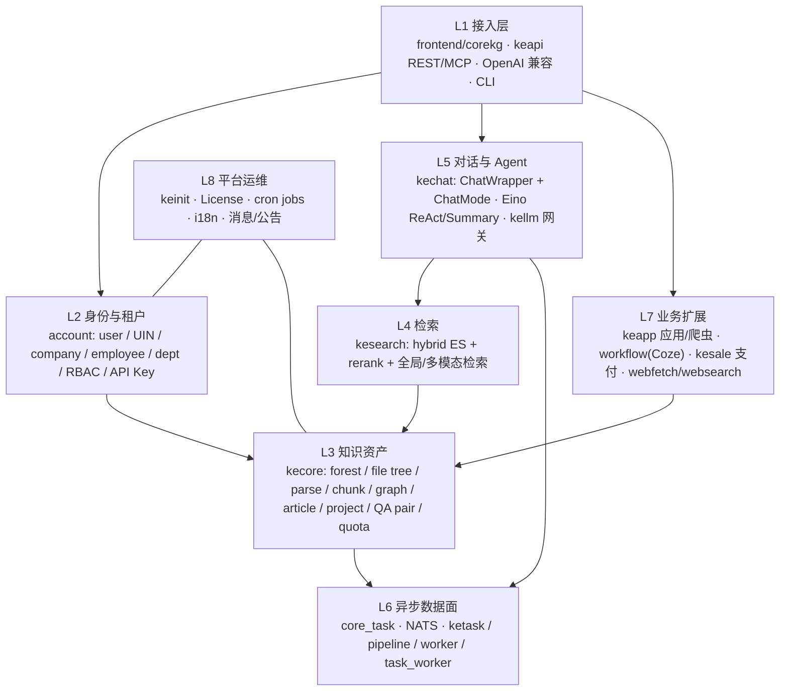
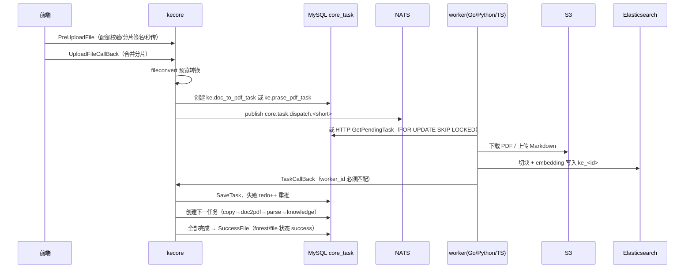
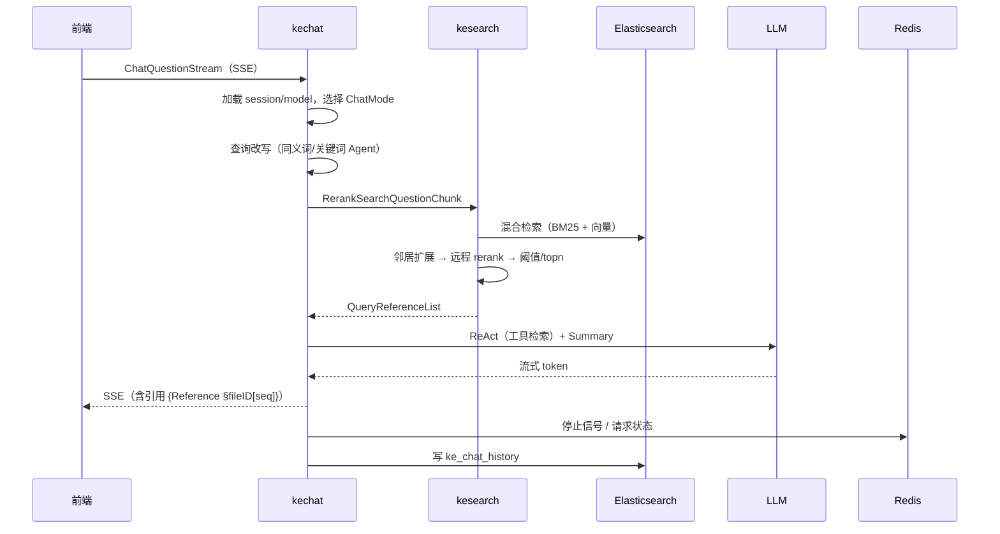

# CoreKG 产品架构现状（基于实际代码）

> **文档性质：现状基线，不是目标蓝图。**
> 与 `docs/platform-architecture-design.md`（明确标注为"规划提案/非当前实现"）区分：本文只描述 **2026-11-01 当前代码里真实存在、可运行、可验证的东西**，并单独列出"代码宣称 vs 实际"的差异。
>
> **证据等级：**
> - `[CODE]` 已在源码中核对（含文件路径）。
> - `[CFG]` 来自配置/部署文件。
> - `[INFERENCE]` 基于代码结构的推断，不能直接当作运行事实。
>
> **基线：** 仓库 `/root/go/src/corekg`，Go module `github.com/insmtx/corekg`，单 module + vendor。

---

## 0. 一页结论（决策摘要）

| # | 结论 | 关键证据 |
|---|---|---|
| 1 | **实际生产形态是"一个业务单体 + 独立数据面 worker + 独立前端"，不是微服务。** 默认 `docker-compose` 中只有 1 个 CoreKG 业务容器。 | `docker-compose.yml:319-358` |
| 2 | **仓库有 18 个 `apps/`，但角色完全不同**：7 个可聚合的 Go 服务、4 个库、3 套 worker 运行时、2 个独立小服务、1 个 vendored Coze、1 个初始化 CLI。 | 见 §2.1 |
| 3 | **对外 HTTP 面共约 422 个 action**（kecore 181、account 92、kechat 72、keapi 27、kesearch 25、keapp 17、corekg 5、ketask 3）。 | `apps/*/internal/apis/**` |
| 4 | **产品主线（知识库 → 文档入库 → 检索 → RAG 问答）是真实完整链路**；图谱、写作、DB/Excel 问答是"有入口、部分实现"；**keapp 网页采集没有接入知识库**，前端对应页面还是 mock。 | §1.1、§7.2 |
| 5 | **模块边界不是按业务域切的，而是按历史包切的。** `account` 反向依赖 `kecore`/`kechat`，`kechat` 依赖 `kecore`，`kesearch` 依赖 `kecore`/`kechat`。 | `grep apps/*/ 的 import`，§6.1 |
| 6 | **数据面事实源是 MySQL `core_task`，NATS JetStream 只是分发加速器**；同时存在 NATS 分发和 HTTP 拉取两条路径。 | `pkgs/task/*`、`apps/ketask/cmd/*` |
| 7 | **多知识库隔离在 ES 层没有完全成立**：索引名本应是 `ke_<ConfigID>`，但全仓 59 处硬编码 `ke_0`。 | `grep '"ke_0"' apps` |
| 8 | **存在若干"编译能过、运行不完整"的组合**：独立 `kecore` 没有初始化 NATS/任务回调，无法完成入库；`corekg` 单体没有初始化 `kesale`，支付链路缺失；单体里 keapi MCP 默认回调 `localhost:8086` 而 corekg 监听 `:8080`。 | §7.2 |
| 9 | **文档漂移严重**：`AGENTS.md` 与旧文档里的 `admin`、`keparser`、`keworker` 在代码中已不存在。 | §7.1 |
| 10 | **建议方向：先"收敛单体 + 明确模块契约 + 修数据面可靠性"，不要现在做微服务化。** | §9 |

---

## 1. 产品能力全景

### 1.1 能力矩阵（以代码与前端路由为准）

| 能力域 | 用户入口 | 后端实现 | 状态 | 关键限制 |
|---|---|---|---|---|
| 知识库（Forest）管理 | 前端 `/docs`、`/global` | `forest.*`（kecore） | ✅ 可用 | 4 种库类型：file/qa/cad/data |
| 文件/目录/上传 | 前端 `/docs/detail` | `forest.PreUploadFile/UploadFileCallBack/...` | ✅ 可用 | 分片上传 + 秒传 + 预览转换 |
| 文档解析/切块/索引 | 上传后自动 | `core_task` → ketask/pipeline | ✅ 可用 | 可靠性问题见 §7.3 |
| 知识库 RAG 问答 | 前端 `/QA`、`/docs` | kechat `standard` 模式 | ✅ 可用 | 依赖 ES + rerank 服务 |
| 全局搜索/多模态搜索 | 前端 `/search` | `forest.GlobalSearch*`、`kesearch.*` | ✅ 可用 | 图片/视频/文档三类 |
| 单文档问答（FileQA） | 文档详情 | `forest.FileChat/ListFileQA` | ✅ 可用 | |
| 模型直聊 / OpenAI 兼容 | `/QA`、`/agents` | kechat `model` 模式；`chat.LLM/chat/completions` | ✅ 可用 | 透传上游，模型由 `proxy_llm_models` 配置 |
| Agent 对话 | 前端 `/agents` | kechat `agent`/`forest_agent` | ✅ 可用 | legacy `qachat` 与 Eino 两套并存 |
| 知识图谱问答 | `/graph`、`/docs/knowledge-graph` | Nebula + `graph_search` 模式 | 🟡 部分 | 依赖 Nebula，索引硬编码 `ke_0` |
| Excel / DB 问答 | `/docs/excel`、`/docs/db` | `excel`/`react_excel`/`mysql` 模式 | 🟡 部分 | 能力分散在多套 builder |
| AI 写作 | `/studios`、`/dotpen-web` | `forest.AIWrite`、article 模块 | 🟡 部分 | 与主链路耦合弱，模板部分 Deprecated |
| 知识应用（keapp） | 前端 `/apps` | `keapp.*` | 🔴 骨架 | 前端 mock；爬虫结果不入库；见 §7.2 |
| 网页采集 | 无独立前端 | `keapp` web crawler（NATS） | 🟡 独立可跑 | 只在 standalone 启动 worker；corekg 内未启动 |
| 工作流 / Coze | `/coze` iframe | `apps/workflow`（vendored Coze Studio） | 🟡 可运行 | 只实现了 List/Retrieve 等少数知识库接口 |
| 开放 API | 第三方 | `keapi.*`（API Key） | ✅ 可用 | 27 个 action |
| MCP Server | LLM Agent | `/v3/keapi/mcp`（21 tools） | ✅ 可用 | 单体部署下回调端口需显式配置 |
| CLI | 开发者 | `clients/corekg-cli` | ✅ 可用 | 设备码登录 |
| 身份/组织/部门 | 前端 `/settings/organization` | `account.*` | ✅ 可用 | RBAC 有已知缺陷，见 §7.4 |
| 角色/权限 | `/settings/organization` | position/privilege | ✅ 可用 | 14 个 `PRequireEmployee` 路由不可达 |
| API Key | `/settings/api-key` | `account_api_key` | ✅ 可用 | keapi 未校验 API 级权限 |
| 套餐/配额/订单/支付 | `/settings/purchase`、`/settings/order-management` | kecore membership + kesale | 🟡 部分 | corekg 单体未初始化 kesale |
| 公告/站内信 | `/announcement` | `forest.ListAnnouncement/...` | ✅ 可用 | |
| 部署初始化 | 部署阶段 | `keinit` | ✅ 可用 | |
| License | 部署阶段 | corekg license middleware | ✅ 可用 | 私有化模式 |
| 运营后台（admin） | — | **不存在** | ❌ | 文档中的 `apps/admin` 已不在仓库 |

### 1.2 四类使用者与入口

```
终端用户        → frontend/corekg (React SPA) → /v3/* (account.* 走 /v2/*)
开发者/Agent    → keapi REST + OpenAI 兼容 + MCP + corekg-cli
外部系统/Coze   → workflow (Hertz :8899) → /v3/forest.*、/v3/kesearch.*
部署/运维       → keinit CLI、License、cron jobs、docker-compose
```

---

## 2. 运行形态与部署拓扑

### 2.1 `apps/` 下 18 个目录的真实角色

| 目录 | 角色 | 是否可部署 | 说明 |
|---|---|---|---|
| `corekg` | **聚合单体（生产主进程）** | ✅ | 挂载 kecore/kechat/account/keapi/ketask/kesearch/keapp + wecom |
| `kecore` | 知识资产服务 | ✅（但入库不完整） | 181 路由，5.3 万行 |
| `kechat` | 对话/Agent 服务 | ✅ | 72 路由，2.5 万行 |
| `account` | 身份/租户/RBAC | ✅ | 92 路由，1.7 万行 |
| `keapi` | 开放 API + MCP | ✅ | 27 路由 + 21 MCP tools |
| `kesearch` | 检索服务 | ✅ | 25 路由 |
| `ketask` | **Go worker 集合 + 控制面** | ✅ | 7 种 worker 子命令 |
| `keapp` | 知识应用 + 网页爬虫 | ✅（半成品） | 17 路由 |
| `kellm` | LLM 网关**库** | ❌ | 只经 kechat 暴露 `chat.LLM/chat/completions` |
| `einonodes` | Eino 节点/图**库** | ❌ | 被 kechat 引用 |
| `nodes` | ChatModel 工厂**库** | ❌ | 38 行，被 kechat 引用 |
| `kesale` | 支付/订单**库** | ❌ | 仅 kecore 初始化 |
| `keinit` | 部署初始化 CLI | ✅ | 也提供 status 探针 |
| `workflow` | Vendored Coze Studio 后端 | ✅ | Hertz `:8899`，67 万行 |
| `pipeline` | Python 文档解析/切块 worker | ✅ | analyser + chunker |
| `worker` | TypeScript worker | ✅ | 与 pipeline 功能重叠 |
| `webfetch` | 单 URL 读取服务 | ✅ | 独立部署，API Key |
| `websearch` | Web 搜索服务 | ✅ | 独立部署，API Key |

> 注意：`apps/pipeline` 与 `apps/worker` 没有 Go 代码，`apps/workflow` 不遵循仓库的 `Routers/Migrates/RunJob` 约定。

### 2.2 生产拓扑（`docker-compose.yml` 实际内容）

```mermaid
flowchart TB
    FE["frontend/corekg<br/>Nginx + React SPA"]

    subgraph APP["业务进程（单容器）"]
        CK["corekg :8080<br/>kecore+kechat+account+keapi+ketask+kesearch+keapp"]
        WF["workflow (可选) :8899"]
    end

    subgraph DATA["数据面"]
        MYSQL[("MySQL 8.4<br/>core/account/knownow/chat/sale/opencoze")]
        ES[("Elasticsearch 8.18<br/>ke_0 / ke_chat_history")]
        REDIS[("Redis 8.2")]
        MINIO[("MinIO / S3")]
        NEBULA[("NebulaGraph 3.8")]
        NATS[("NATS JetStream")]
    end

    subgraph WORKERS["异步 worker"]
        KEINIT["keinit（一次性初始化）"]
        AN["pipeline analyser<br/>MinerU → Markdown"]
        CH["pipeline chunker<br/>切块 → embedding → ES"]
        D2P["ketask doc2pdf"]
        DESC["ketask description"]
    end

    FE --> CK
    FE --> WF
    CK --> MYSQL & ES & REDIS & MINIO & NEBULA & NATS
    WF --> MYSQL & ES & MINIO
    WF -. HTTP /v3/forest.* /v3/kesearch.* .-> CK
    KEINIT --> MYSQL & ES & MINIO
    AN --> MINIO & ES
    CH --> MINIO & ES
    AN --> CK
    CH --> CK
    D2P --> CK
    DESC --> CK
    NATS -. 任务分发 .-> D2P
```

### 2.3 两种形态的差异（单体不是简单拼装）

| 维度 | 独立 app | `corekg` 单体 |
|---|---|---|
| URL 前缀 | 通常单前缀（keapi `/v3`、account `/v2`） | **同时挂 `/v2` 和 `/v3`**（`apps/corekg/cmd/main.go:92-94`） |
| 任务系统 | kecore 独立启动**没有** `task.InitDB` / `SetNATSBridge` / 回调注册 | 完整初始化（`apps/corekg/cmd/init.go:66-97`、`internal/taskbiz`） |
| 支付 | kecore 独立会 `kesale.Init` | **corekg 不初始化 kesale** |
| License | 无 | 全局中间件 + 每日校验 |
| Nebula | 各 app 自行初始化 | 由 `DeployMode`/`ENABLE_NEBULA_GRAPH` 控制 |
| MCP | keapi 回调 `mcp.addr`（默认 `:8086`） | 需显式配置，否则回调错端口 |
| Workflow | 独立 Hertz | 可内嵌（`workflow.enabled`，默认 false） |

---

## 3. 逻辑架构（按代码职责分层）



### 3.1 L1 接入层

- **前端**：`frontend/corekg`（React 18 + Vite + antd），真实产品壳。路由见 `frontend/corekg/src/router/index.tsx:168-460`。
- **keapi**：外部 API + MCP；OpenAI 兼容只有 `keapi.chat/chat/completions`。
- **鉴权**：`Authorization: Bearer yg-...` → `RoleAPI` → 查 `account_api_key`；普通请求走 JWT → `InjectLoginStatus` 注入 UIN/CompanyID/EmployeeID。
- **action 即 URL**：`eng.P("forest.ListForest")` → `POST /v3/forest.ListForest`。

### 3.2 L2 身份与租户（`apps/account`）

核心模型：

```
user（自然人）
  └─ user_identification（UIN，映射到 company 或 individual）
       └─ account_employee（user + company + uin + sys_role）
            ├─ account_department（公司内部门树）
            └─ account_rel_employee_position → account_position → account_privilege
company（租户：版本 + JSON 配额）
account_api_key（yg- 前缀，可绑定资源）
```

- 登录方式：邮箱/手机号 + 密码（bcrypt）、企业微信 OAuth、微信网页 OAuth、私有化密码、CLI 设备码、OBO 短期令牌。
- **没有 LDAP**；README 宣称的短信验证码登录不存在。
- RBAC：系统角色 `sys_admin/sys_employee/sys_teacher/sys_student` + 岗位/权限关系表。

### 3.3 L3 知识资产（`apps/kecore`，最大业务模块）

```
ke_forest（知识库）
  ├─ ke_forest_file（文件与目录同一张表，parent_id/parent_ids 建树）
  │    ├─ core_upload_files（物理对象：S3 路径、hash、分片）
  │    ├─ core_task（解析/切块/索引任务，事实源）
  │    └─ ES index ke_<ConfigID>（chunk/image/table/video/formula）
  ├─ ke_forest_graph → ke_forest_graph_version → Nebula space
  ├─ ke_qa_session / ke_forest_qa / ke_file_qa
  └─ ke_resource_scope（public/company/user/department × manage/view/ban）
```

- 服务包：`svcforest`、`svcforestfile`、`svcforestnode`、`svcgraph`、`svcperm`、`svcresource`、`svcmembership`、`svcarticle`、`svcproject`、`svcdbforest`、`svcexcelforest`、`fileconvert`、`svcannouncement`、`svcmessage` 等。
- 配额在路由级中间件执行：`DiskPreQuotaMDV2`、`QAChatQuotaMD`、`GraphQuotaMD`、`ArticleQuotaMD`；私有化部署模式下全部跳过。

### 3.4 L4 检索（`apps/kesearch`）

- **混合检索**：Elasticsearch `script_score` = 文本分 + 向量余弦相似度。
- **两阶段重排**：ES 召回 → 邻居 chunk 扩展 → 远程 rerank `/text_1`/`/text_2` → 阈值/topn/topm 截断 → 按文件聚合 + 摘要。
- 配置：`knowledge/reranksearchcfg`（topn 30 / topm 15 / topk 5 / threshold 0.5）。
- 全局搜索：ES 聚合 + `company_id`/可见 Forest/封禁列表过滤。
- **已知缺陷**：rerank/global/`DisableFileChunk` 等路径硬编码 `"ke_0"`，多知识库配置下会读错索引。

### 3.5 L5 对话与 Agent（`apps/kechat`）

调度核心：`services/svcchat/chat.go:102-138` 按 `ChatSession.BaseType` 分发。

| BaseType | 实现 | 说明 |
|---|---|---|
| `standard` | `ForestChatMode` | 改写 → ReAct + 知识库检索工具 → 总结 |
| `model` | `DirectModelChatMode` | 直连模型，可带分析文件/联网工具，最多 20 轮 |
| `forest_agent` | `ForestAgentChatMode` | 知识库 + 代码/文件工具（keapi 路径使用） |
| `graph_search` | `GraphSearchChatMode` | Nebula 图谱检索 |
| `react_excel` / `excel` | `ExcelChatMode` / `ExcelChatBuilder` | 代码/SQL/图表 |
| `mysql` | `MysqlChat` | 数据库问答 |
| `graph_qa` | `ForestGraphChat` | 图谱问答 |
| `external_data` | `ExternalChatBuilder` | 外部数据源 |
| `agent` | `qachat.AgentChat` | legacy agent |

- **ChatWrapper**：`chat/wrapper/wrapper.go:28-88`，负责 BaseType → ChatMode 映射与结果归一化。
- **Eino**：`pkgs/einotools` 提供 ReActAgentService、SummaryAgent、SSE Printer、sandbox、MCP 工具；`apps/einonodes` 提供 QA/Excel/External 图。
- **流式**：SSE（非 WebSocket）；停止信号通过 Redis。
- **数据**：会话/模型/Agent 在 MySQL `chat_*`，**消息在 ES `ke_chat_history`**。

### 3.6 L6 异步数据面（见 §5.1 详图）

- 事实源：MySQL `core_task`（6 状态 + redo）。
- 分发：NATS JetStream `CORE_TASK_DISPATCH`（`core.task.dispatch.<short>`）。
- 消费：Go `ketask`、Python `pipeline`、TS `worker` 三套实现并存。
- 回调：HTTP `knowledge.TaskCallBack` + NATS `CORE_TASK_RESULT` 双路径。

### 3.7 L7 业务扩展

- **keapp**：`ke_application` + 网页资源/规则/爬取任务；NATS pull consumer。**爬取结果 `index_status=pending`，不会写入 ES/知识库**。
- **workflow**：Coze Studio 全量 vendored，独立 `opencoze` 库；对 CoreKG 只通过 HTTP 调 `forest.ListForest`、`forest.ListFile`、`kesearch.RerankSearchChunk`。
- **kesale**：微信 Native 支付 + Redis 回调幂等 + 每分钟订单校验（README 说每小时，代码是每分钟）。
- **webfetch/websearch**：面向外部/Agent 的"先搜后读"，API Key 鉴权，未挂载进 corekg。

### 3.8 L8 平台运维

- `keinit`：建库建表、执行 `scripts/mysql` 版本化脚本、ES DSL、MinIO bucket、默认模型/API Key、CoreSetting、返回 K8s namespace UID。
- License：`corekg.CheckLicense/GetLicenseInfo/RegisterLicense` + 每日后台校验 + 72h 宽限。
- Cron：`SyncMysqlTable`、`GenerateUsersHotWords`、`PackageQuotaExpireNotify` 等。

---

## 4. 数据架构

### 4.1 存储全景

| 存储 | 用途 | 关键事实 |
|---|---|---|
| **MySQL** | 业务元数据 + 任务状态 | 5 个逻辑库：`core`/`account`/`knownow`/`chat`/`sale`；Coze 另有 `opencoze` |
| **Elasticsearch** | chunk 向量 + 文本检索 + 聊天历史 | 知识索引 `ke_<ConfigID>`（大量代码硬编码 `ke_0`）；历史 `ke_chat_history` |
| **Redis** | 登录态、SSE 停止、分布式锁、缓存、支付幂等 | 多个 pool：`knowledge`/`core`/`ketask` |
| **MinIO / S3** | 原始文件、预览 PDF、解析 Markdown、图片 | bucket 来自 `core/cos-ke`；前缀 `ke/`、`algo-lke/{uin}/{forestID}` |
| **NebulaGraph** | 知识图谱 | 每个图谱版本一个 space（`ke_forest_graph_version.space_name`） |
| **NATS JetStream** | 任务分发/结果 | `CORE_TASK_DISPATCH`、`CORE_TASK_RESULT`、`KEAPP_CRAWL_STREAM` |

### 4.2 MySQL 表分组（按库）

| 库 | 主要表 |
|---|---|
| `account` | `user`、`user_identification`、`company`、`account_employee`、`account_department`、`account_position`、`account_privilege`、`account_api_key`、`account_wechat_binding` |
| `core` | `core_upload_files`、`core_task`、`corekg_cron_jobs`、`corekg_cron_records` |
| `knownow` | `ke_forest`、`ke_forest_file`、`ke_file_parse`、`ke_parse_history`、`ke_forest_graph*`、`ke_graph_*`、`ke_resource_scope`、`ke_article*`、`ke_project`、`ke_package`、`ke_company_quota`、`ke_qa_session`、`ke_forest_qa`、`ke_file_qa`、`ke_tag*`、`ke_application`、`ke_web_*` |
| `chat` | `chat_session`、`chat_question`（元数据）、`chat_model`、`chat_agent`、`chat_agent_version`、`chat_chart`、Coze 映射 |
| `sale` | `sale_order`、`sale_order_item`、`sale_payment_record` |

### 4.3 数据所有权问题（重要）

- `ke_application` / `ke_web_*`（keapp）**没有 SQL 迁移脚本**，依赖 GORM AutoMigrate；与 `scripts/mysql` 版本化约定不一致。
- `chat_question` 的正文在 **ES**，MySQL 只有会话/模型/Agent；跨存储一致性无事务保障。
- 任务状态在 MySQL，产物在 S3，索引在 ES —— **三处状态没有统一事务边界**。

---

## 5. 四条核心链路

### 5.1 文档入库（最复杂、也最脆弱）



任务类型：`ke.copy_task`、`ke.doc_to_pdf_task`、`ke.prase_pdf_task`、`ke.prase_video_task`、`ke.mind_map_task`、`ke.analysis_task`、`ke.description_task`、`ke.knowledge_task`、`ke.insert_index`、`ke.graph_task`、`ke.graph_file_task`。

**事实源与分发**：`core_task` 是唯一事实源；NATS 只是提速。worker 可以完全不订阅 NATS，靠 HTTP 轮询也能工作。

### 5.2 RAG 问答



### 5.3 开放 API / MCP

- REST：`/v3/keapi.<Action>`，API Key（`yg-`）鉴权，27 个 action。
- OpenAI 兼容：`/v3/keapi.chat/chat/completions`，固定模型名 `forest-chat`。
- MCP：`ANY /v3/keapi/mcp`（StreamableHTTP），21 个 tools；**tool 内部再 HTTP 调自己**（`mcp.addr`），不是直接调 service。
- CLI：设备码登录 → `~/.corekg/*.json` → 调 keapi。

### 5.4 支付与配额

- 下单：kecore `forest.CreateOrder` → `kesale` 创建 `sale_order` → 微信 Native 预支付。
- 回调：`forest.HandleNotifyWX` → 验签 + AES-GCM 解密 → Redis 锁幂等 → 更新订单 → 业务回调（开通套餐）。
- 校验：cron 每分钟查询 pending 订单。
- **单体缺口**：`corekg` 只挂 kecore 路由，不执行 `kesale.Init`，支付链路在默认单体部署下不可用 `[CODE]`。

---

## 6. 模块依赖与耦合

### 6.1 实际 import 依赖矩阵（`apps/<x>` 被谁引用）

| 被依赖 | 主要依赖方 | 性质 |
|---|---|---|
| `kecore` | account(16)、keapi(21)、kechat(56)、kesearch(17)、ketask(9)、keapp(5)、corekg、keinit | **核心模型被所有层直接 import** |
| `kechat` | kecore(32)、keapi(17)、kesearch(20)、account(8)、einonodes(16)、keinit | 对话模型/枚举被反向依赖 |
| `account` | kecore(28)、kechat(14)、keapi(10)、kesearch(8)、ketask(1) | 登录态/鉴权中间件 |
| `kesearch` | kecore(25)、kechat(9)、keapi(6)、ketask(3) | 检索实现被直接调用 |
| `kesale` | kecore(12) | 仅支付 |
| `kellm` | kechat(1)、keapi(4，仅 DTO) | 网关 |

**结论**：`kecore`、`kechat`、`account`、`kesearch` 四者形成**包级网状耦合**（不是 Go import cycle，因为拆在不同包，但模块边界已名存实亡）。

### 6.2 代码规模

| 模块 | Go 行数（非测试） | 占比 |
|---|---:|---:|
| `workflow`（vendored Coze） | 675,180 | 81% |
| `kecore` | 53,391 | 6.4% |
| `kechat` | 24,806 | 3.0% |
| `account` | 17,050 | 2.1% |
| `kesearch` | 7,655 | 0.9% |
| `websearch` | 7,357 | 0.9% |
| `ketask` | 4,443 | 0.5% |
| `keapi` | 4,297 | 0.5% |
| `webfetch` | 3,757 | 0.5% |
| `keapp` | 2,908 | 0.3% |
| `einonodes` | 2,740 | 0.3% |
| `kesale` | 2,383 | 0.3% |
| `keinit` | 2,192 | 0.3% |
| `kellm` | 1,610 | 0.2% |
| `corekg` | 1,369 | 0.2% |
| `nodes` | 38 | — |
| `pipeline`（Python） | 5,828 | — |
| `worker`（TS） | 6,095 | — |

> 去掉 vendored Coze 后，CoreKG 自身约 **15 万行 Go + 1.2 万行 Python/TS**。

---

## 7. 现状 vs 文档/宣称（决策必读）

### 7.1 不存在的应用 / 文档漂移

| 文档宣称 | 实际情况 |
|---|---|
| `apps/admin` 运营后台 | **目录不存在**（`AGENTS.md`、`docs/apps-application-scenarios.md` 均过期） |
| `apps/keparser` | 不存在；能力由 `apps/ketask` + `apps/pipeline` 取代；仅剩注释/指标常量 |
| `apps/keworker` | 不存在；等价物是 `apps/ketask`、`apps/pipeline`、`apps/worker` |
| `Makefile` 默认 `APP=roc` | 不存在 `roc` 应用，必须显式传 `APP` |
| 公开 API 是标准 `/v1/chat/completions` | 实际是 `/v3/keapi.chat/chat/completions` |
| 运营用户 `RoleEmployee` 可用 | 全仓没有任何地方赋值 `RoleEmployee`，14 个 `PRequireEmployee` 路由不可达 |

### 7.2 已实现但未接线（最容易误判为"已有能力"）

| 能力 | 代码状态 | 缺口 |
|---|---|---|
| keapp 网页采集 → 知识库 | 爬虫可抓取、去重、存 `ke_web_resource` | `index_status` 永远 `pending`，`forest_id` 不写入，没有 ES 索引 |
| keapp 在 corekg 中运行 | 只挂了 Routers | 未启动 worker；`TriggerCrawl` 因 NATS 未连接直接报错 |
| 前端 `/apps` | 页面存在 | 使用 `MOCK_APPLICATIONS`，未调用 keapp |
| 独立 `kecore` 文档入库 | 路由/服务齐全 | `main.go` 未 `task.InitDB`/`SetNATSBridge`，无法派发任务 |
| `corekg` 支付 | kecore 路由存在 | 未 `kesale.Init`，无支付初始化/回调注册 |
| `corekg` MCP | MCP 路由已挂 | `mcp.addr` 默认 `:8086`，单体监听 `:8080` |
| workflow 对接知识库 | List/Retrieve 已实现 | 其余方法返回 `ErrYyguUnsupported` |
| TypeScript worker | 有 8 个 dispatch consumer | 部分 consumer 的 subject/stream 与 Go 端不一致，疑似死代码 |

### 7.3 缺陷与风险清单

| 严重度 | 问题 | 影响 |
|---|---|---|
| **高** | ES 索引名 59 处硬编码 `ke_0` | 多知识库/多租户隔离失效，检索串库 |
| **高** | 无 `running` 超时回收器（`TaskStatusTimeout` 从未被写入） | worker 崩溃后任务永久卡住，只能人工 `RetryParse` |
| **高** | NATS 分发用 `PeekOnePendingTask`（不加锁） | 与 HTTP 拉取并发时可能重复投递 |
| **高** | 切块先 delete-by-query 再 bulk upsert | embedding/写入失败会造成索引数据丢失 |
| **中** | NATS result `Nak()` 无最大投递/DLQ | 毒消息无限重试 |
| **中** | Python analyser 回调失败只记日志 | 任务静默停滞 |
| **中** | `kecore` 独立部署无法入库 | 破坏"每个 app 可独立运行"的假设 |
| **中** | `corekg` 不初始化 kesale | 单体部署支付不可用 |
| **中** | 单体 `/v2` + `/v3` 双挂载 | 接口面翻倍，鉴权/白名单易漏 |
| **中** | 三套 worker（Go/Python/TS）功能重叠 | 运维/排障/交付成本高 |
| **低** | `foresttype.KnownowTask`（`ke_task`）遗留 | 表在、无人用 |
| **低** | 大量 Deprecated 路由/模板 | 接口面膨胀 |
| **低** | `apps/kesale` README 说每小时校验，实际每分钟 | 文档失真 |

### 7.4 权限与安全注意

- keapi 中间件名为 `RequireAPIKeyPrivilege`，实际**只验证 key 存在/未过期，不校验 API 级权限**；相关权限表基本未使用。
- `RoleEmployee` 未赋值 → 运营类路由不可达。
- `test-forward-auth` 调试端口 `:30010` 被打进 account 二进制。
- 私有化模式会跳过全部配额中间件（预期行为，但需在商务/交付侧明确）。
- Coze 模型 Create/Update 会跨库写入 `opencoze`，下线 Coze 前必须先解耦。

---

## 8. 架构评估

### 优势（应保留）

1. **主链路闭环完整**：上传 → 解析 → 切块 → 索引 → 检索 → RAG 回答 → 引用，且已产品化。
2. **检索质量投入深**：混合检索 + 邻居扩展 + 远程 rerank + 阈值回退，不是简单 top-k。
3. **Eino 生态已落地**：ReAct/Summary/SSE/工具/沙箱/MCP 都有实现，Agent 扩展成本低。
4. **多租户模型完整**：UIN + company + employee + department + resource scope + 配额。
5. **开放面齐全**：REST + OpenAI 兼容 + MCP + CLI，四种接入方式。
6. **单体部署体验好**：一个 `docker-compose` 起完整产品，适合私有化。

### 负债（应处理）

1. **模块边界名存实亡**：`account`/`kecore`/`kechat`/`kesearch` 互相 import，任何"拆服务"都会先撞到模型耦合。
2. **三种 worker 实现并存**：同一任务契约三套代码，交付时选型不清晰。
3. **配置与初始化分散**：每个 app 自己 init DB/ES/Redis/S3/Nebula，单体里重复初始化、顺序敏感。
4. **文档与代码漂移**：新成员/AI 助手会被 `AGENTS.md` 误导。
5. **数据面可靠性不足**：无超时回收、无 DLQ、索引先删后写。
6. **多知识库隔离未完成**：`ke_0` 硬编码是产品级风险。
7. **Vendored Coze 占 81% 代码量**：升级/裁剪/安全审计成本高，且与主产品边界不清。

---

## 9. 决策建议

### 9.1 三个可选方向

| 方向 | 做法 | 成本 | 适用前提 |
|---|---|---|---|
| **A. 收敛单体（推荐）** | 保留 corekg 作为唯一产品运行时；内部按 §3 分层整理包边界；worker 作为独立数据面；workflow/keapp 作为可选卫星 | 低-中 | 目标是私有化交付 + SaaS 单产品 |
| B. 真微服务 | 按 kecore/kechat/kesearch/account 拆服务，先解模型耦合 | 高（6-12 个月） | 有独立扩缩容/多团队并行刚需 |
| C. 平台化（愿景文档） | Platform + Capability + Application 三层，微前端，多产品 | 很高 | 明确要做 OEM/多产品矩阵 |

**建议：A + 只抽取 3 条天然缝**：
1. **AI 网关**（kellm）：已有 OpenAI 兼容契约，最容易独立。
2. **检索**（kesearch）：输入输出清晰（query → references），但需先消灭 `ke_0` 硬编码。
3. **异步 worker**：已经是独立进程，只需统一任务契约、砍掉重复实现。

### 9.2 推荐路线（按优先级）

**P0（1-2 个月，先止血）**
1. 统一 ES 索引解析：全部走 `forest.EsIndex()`，删除 59 处 `ke_0`。
2. 任务可靠性：加 `running` 超时回收、NATS 最大投递 + DLQ、切块改为"写新索引再切换"。
3. 修正部署组合：corekg 初始化 kesale；keapi MCP `mcp.addr` 必填；独立 kecore 要么补 NATS 初始化，要么明确"仅单体可用"。
4. 重写 `AGENTS.md` / `docs/apps-application-scenarios.md`，删除不存在的 app。

**P1（2-4 个月，收敛边界）**
5. 定义 4 个模块契约包（`knowledge-api`、`chat-api`、`identity-api`、`search-api`），禁止跨模块直接 import `models`。
6. worker 二选一：保留 Python pipeline（解析/切块）或 TS worker，Go ketask 只保留轻量任务；写死一份任务契约文档。
7. 决策 keapp / workflow 的去留（见 9.3）。

**P2（4-6 个月，产品化）**
8. 补齐 keapp → Forest 的入库链路，或直接下线 keapp。
9. 把 workflow 的 CoreKG 适配从"3 个方法"补到可用，或明确它是独立产品。
10. 多租户压测：多 Forest、多公司、`ke_<id>` 隔离验证。

### 9.3 需要你拍板的问题

1. **产品形态**：CoreKG 是"一个知识库产品"，还是"一个可组装的知识平台"？这决定 A/B/C。
2. **keapp 去留**：网页采集→知识库这条链路是否在近期产品路线内？不在就下线，避免半成品维护成本。
3. **workflow/Coze 定位**：是主产品能力，还是可选嵌入？决定是否继续承担 67 万行 vendored 代码。
4. **worker 技术栈**：Python（MinerU 生态强）还是 TS（与前端同栈）？必须二选一。
5. **私有化 vs SaaS 优先级**：私有化要求"单包可部署"，SaaS 要求"多租户隔离 + 弹性"，两者对架构约束不同。
6. **图谱/写作的商业价值**：当前是"有代码、弱产品化"，是否继续投入。

---

## 附录 A：路由清单（按服务）

| 服务 | POST | GET | ANY | 合计 | 命名空间 |
|---|---:|---:|---:|---:|---|
| `kecore` | 180 | 1 | 0 | 181 | `forest.*` |
| `account` | 87 | 4 | 1 | 92 | `account.*` |
| `kechat` | 71 | 1 | 0 | 72 | `chat.*` |
| `keapi` | 26 | 1 | 0 | 27 | `keapi.*` + MCP |
| `kesearch` | 24 | 1 | 0 | 25 | `kesearch.*` |
| `keapp` | 17 | 0 | 0 | 17 | `keapp.*` |
| `corekg` | 5 | 0 | 0 | 5 | `corekg.*` / `knowledge.*` |
| `ketask` | 2 | 1 | 0 | 3 | `knowledge.*` |
| **合计** | **412** | **9** | **1** | **422** | |

## 附录 B：关键术语

| 术语 | 含义 |
|---|---|
| Forest | 知识库（file/qa/cad/data 四种类型） |
| File | 知识库中的文件或目录（`ke_forest_file`） |
| Chunk | ES 中的检索单元（文本/图片/表格/视频/公式） |
| UIN | 用户在某个租户下的统一身份 |
| BaseType | 会话类型，决定 ChatMode 分发 |
| core_task | 异步任务事实表 |
| action | 形如 `forest.ListForest` 的路由标识，直接映射 URL |
| CoreSetting | 存在 MySQL 的运行时配置（模型、ES、存储、rerank 等） |

---

> **维护约定**：本文是"现状基线"。任何 app 新增/删除、路由命名空间变化、数据面契约变化，都应同步更新本文；愿景类内容继续放在 `docs/platform-architecture-design.md`。
